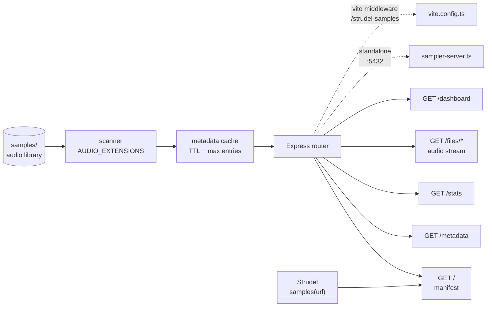

# strudel-sampler-server-vite

**The sample-library backend for Strudel live-coding — point it at a folder of audio, get a Strudel-compatible JSON API, file streaming, and a built-in dashboard. Runs as a standalone microservice or as Vite middleware.**

[](https://github.com/toxicwind/strudel-sampler-server-vite/actions)


## Why this exists

Strudel's `samples()` needs a URL that speaks its manifest format. This service is that URL: drop your drum kits and instruments into a folder, and it indexes them into a Strudel-compatible manifest, serves metadata and audio, and gives you a dashboard to verify everything before a session. No database, no build step for the dashboard, no ceremony.

It's consumed by [`strudel-dev-vite`](https://github.com/toxicwind/strudel-dev-vite) as a git submodule (`apps/sampler`), but it runs perfectly well standalone.

## Features

- 📂 **Library scanning** — indexes `.mp3` `.wav` `.ogg` `.flac` `.m4a` `.aiff` (extend via `AUDIO_EXTENSIONS` in the plugin source)
- 🗂️ **Strudel-compatible manifest** — `GET /` returns JSON that `Strudel.samples()` consumes directly
- 📊 **Rich metadata** — format, duration, size via `music-metadata`, cached with TTL + max-size eviction
- 🔥 **Hot reload** — file watchers invalidate caches instantly; in middleware mode they also notify the Vite dev server
- 🖥️ **Embedded dashboard** — search, filter, and preview samples at `/dashboard`, served from a single self-contained HTML string
- 🔌 **Two serving modes** — standalone Express server on `:5432`, or Vite middleware mounted at `/strudel-samples`
- 🛡️ **Traversal-safe file serving** — `/files/*` rejects paths escaping the library root (403) and missing files (404)
- 🐳 **Container-ready** — multi-stage Dockerfile plus `docker-compose.yml` with healthcheck on `/stats`, read-only sample mount, `restart: unless-stopped`
- 🧪 **CI on every push** — build (Node 18/20 matrix), Docker, and release workflows

## How it fits together



## Quick start

```bash
git clone git@github.com:toxicwind/strudel-sampler-server-vite.git && cd strudel-sampler-server-vite
npm install && cp .env.example .env
npm run sampler
```

Open <http://localhost:5432/dashboard/> to verify your library, then in Strudel:

```js
samples('http://localhost:5432/')
s("bd sd")
```

Prefer middleware mode inside a Vite project? `npm run dev` mounts the same router at <http://localhost:5173/strudel-samples>.

## API surface

| Route | Returns |
| --- | --- |
| `GET /` | JSON manifest compatible with `Strudel.samples()` |
| `GET /manifest` | Manifest only (used by the dashboard) |
| `GET /metadata` | Cached metadata: format, duration, size |
| `GET /stats` | Service stats: counts, root path, cache state (also the Docker healthcheck) |
| `GET /files/:relativePath` | Audio file stream (`Accept-Ranges: bytes`) |
| `GET /dashboard` | Embedded dashboard UI (dev builds) |

## Architecture

| File | Role |
| --- | --- |
| `vite-plugin-strudel-sampler.ts` | The whole service: scanner, cache, Express router, Vite plugin, `createStandaloneServer()` |
| `sampler-server.ts` | Standalone entry point — reads env config, starts the server |
| `vite.config.ts` | Middleware-mode config (mounts at `/strudel-samples` on `:5173`) |
| `Dockerfile` | Multi-stage build → `node dist/sampler-server.js` on `:5432` |
| `docker-compose.yml` | One-container deployment with healthcheck + read-only volume |
| `deploy-prod.py` / `run.sh` | Production deploy and local-run helpers |
| `samples/` | Your audio library (git-ignored) |

## Configuration

Copy `.env.example` to `.env`:

| Variable | Default | Meaning |
| --- | --- | --- |
| `STRUDEL_SAMPLES` | `$HOME/strudel-dev/samples` (code fallback; `.env.example` sets `./samples`) | Audio library root |
| `PORT` | `5432` | Standalone server port |
| `CACHE_TTL` | `3600000` | Metadata cache TTL in ms (`0` disables) |
| `CACHE_MAX_SIZE` | `500` | Max cached metadata entries before eviction |
| `HOT_RELOAD` | `true` | File-watch invalidation (any value other than `false` enables) |

For Portainer deployments, `docker-compose.yml` reads the same variables and `.env.portainer` documents the shape.

## Development

| Command | What it does |
| --- | --- |
| `npm run dev` | Vite middleware server with live dashboard at `/dashboard` |
| `npm run sampler` | Standalone server via `tsx` (development) |
| `npm run sampler:prod` | Runs the compiled `dist/` output |
| `npm run build` | TypeScript build into `dist/` |
| `npm run type-check` | Strict type checking |
| `npm run lint` | ESLint checks |

Contributing (from `CONTRIBUTING.md`): fork & branch → `npm ci`, `npm run type-check`, `npm run build` → commit & PR. A PR template and bug/feature issue templates are in the repo.

Deploy the container:

```bash
docker build -t strudel-sampler .
STRUDEL_SAMPLES=/path/to/your/library docker compose up -d
```

## Sample library tips

- Mirror Strudel's naming expectations so folders map to playable tokens (`samples/drums/bd`, `samples/fx/risers`).
- Keep each kit or instrument under a dedicated folder (`samples/drums/roland-tr-808/`, `samples/keys/wurlitzer/`); use descriptive filenames for multi-layered recordings.
- After adding files, check the dashboard for duration, format, and size before handing control to the dev UI.

## License and security

- **License:** `package.json` declares MIT, but no `LICENSE` file is present in the tree yet — one should be added to make the grant effective.
- **Security:** `SECURITY.md` currently lists a placeholder contact address; until it's updated, use GitHub issues for security reports. No secrets are committed — local overrides belong in `.env` (git-ignored).
